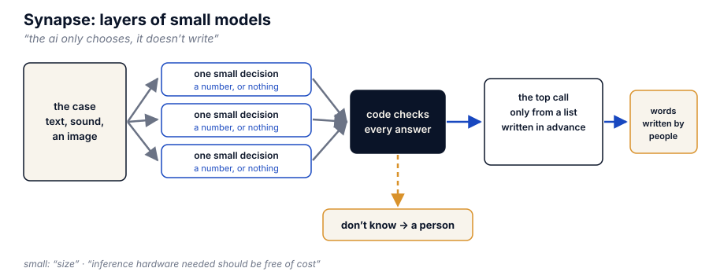
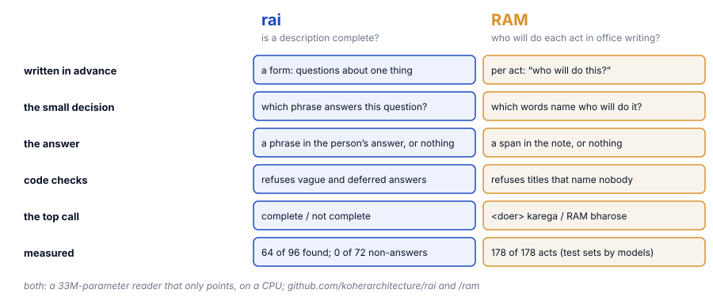

<h1 align="center">Synapse</h1>

<p align="center"><strong>Layers of small models: a method for using AI in which no model writes a word.</strong></p>

<p align="center">
  <a href="LICENSE-METHOD.md"></a>
  <a href="LICENSE"></a>
  <a href="CITATION.cff"></a>
  <a href="https://splitdomaincognition.org"></a>
</p>

---

The method is Prayas Abhinav's. He first set it out on 24 September 2026, and it is published by Koher. The method itself, in his words, is in **[METHOD.md](METHOD.md)**. This page gives its shape, two working models built on it, a small scaffold in code, and how to cite it.

<p align="center"></p>

## Two models built on it

Both are released by Koher. Each has its own reader, fine-tuned from the same 33-million-parameter base, which runs on an ordinary CPU and can only point at words already in front of it.

<p align="center"></p>

**[rai](https://github.com/koherarchitecture/rai)** checks whether a description is complete. A form of questions is fixed before anyone answers. For each question the reader points at the phrase in the person's answer that answers it, or at nothing. Code refuses vague, deferred and empty answers. The top call is one of two words, *complete* or *not complete*, and rai never says why. On four forms it never trained on, version 0.3.8 found 64 of 96 honest answers and counted none of 72 non-answers. It misses real answers more often than it lets a wrong one through; the method prefers that error to the other.

**[RAM](https://github.com/koherarchitecture/ram)** points at who is doing each act in a piece of office writing. A parser finds the acts and asks one fixed question of each: who will do this? The reader points at the words that name the doer, or at nothing. Code refuses titles that name nobody. The top call, for each act, is one of two lines: *&lt;doer&gt; karega* (will do), with the doer copied from the note, or *RAM bharose* (left to chance). On its five test sets, which were written by models and keyed by hand, version 0.5 named the right doer, or nobody, for all 178 acts, against 162 for the parser alone; notes written by office staff have not been measured yet. The doer RAM prints is copied from the note, so no word of it is the model's.

## The code

Three small files in `scaffold/`, to copy into your own work.

- **`layers.py`**, plain Python with no packages, is the part every system built this way shares. `window` lets an answer through only as the number of an item in the list the model was given; anything else, words included, counts as *don't know*. `run` puts a case through each layer, stops it the moment a layer does not know and hands it on, to a person or to rules people wrote in advance, and makes the top call from a table people wrote, so every sentence a person reads comes from that table. A layer's list is either fixed beforehand or taken from the case itself, such as its sentences.
- **`pointer.py`** asks one question of a text given as a list of sentences and answers with the number of the sentence that holds the answer, or nothing. It uses the base that rai's and RAM's readers were fine-tuned from, `deepset/minilm-uncased-squad2`, as it comes. It reads the first 380 or so tokens; an answer past that is not found, and the case is handed on.
- **`chooser.py`**, with no packages, holds a model that scores labels to a fixed list: the number of the item it scores highest, or nothing when that score is under the threshold or the model's top label is not on the list. It has been tried once, with an AudioSet sound classifier (`MIT/ast-finetuned-audioset-10-10-0.4593`) on three made-up sounds, a pure tone, beeps and silence, against a list of doorbell, knock and smoke alarm. It returned nothing for all three, because each sound's top label (*Sine wave*, *Beep, bleep*, *Silence*) is not on the list. That trial shows refusal only; it has not yet been shown choosing a right item, and no threshold was measured for it.

Before a layer is used, its threshold is set on cases keyed by hand before the model sees them, as in the example below.

```bash
python3 scaffold/test_layers.py          # the checks, no packages needed
pip install -r requirements.txt          # torch and transformers, for the pointer
python3 examples/office_note.py          # the worked example
```

**The worked example**, `examples/office_note.py`, asks of twenty short office notes *who will do it?* The notes and their keys were written by hand for it before the reader saw them. The threshold is set on ten notes and reported on the other ten, which it never saw. On those ten the pointer found 4 of the 5 people named and named nobody wrongly; the fifth note (*Imran will buy it tomorrow morning*) scored between *no answer* and the threshold, so it was handed on instead of answered. Every note comes out as one of two fixed sentences, *Sent on: the note names who will do it* or *Returned: the note does not say who will do it*, or as a case handed on. Twenty notes show the method's shape; they are not a measurement of the reader. Tested with Python 3.12 and torch 2.14, with transformers 5.17 and again with 5.20 in a fresh install from `requirements.txt` alone; both gave the same results.

`scripts/check.sh` runs before every release: it refuses without `METHOD.md`, when a check fails, or when anything in the tree looks like a key.

## Cite it

Use GitHub's *Cite this repository* button, which reads `CITATION.cff`, or:

> Abhinav, P. (2026). *Synapse: layers of small models* (Version 1.3). Koher. https://github.com/koherarchitecture/synapse

If you cite a model built on it, cite rai or RAM through their own `CITATION.cff` as well. The idea underneath, Split-Domain Cognition, is at https://splitdomaincognition.org.

## Licence

The method (`METHOD.md`, this README and the figures) is under the Creative Commons Attribution 4.0 International licence: see `LICENSE-METHOD.md`. The scaffold code is under the GNU Affero General Public License v3.0: see `LICENSE`.
